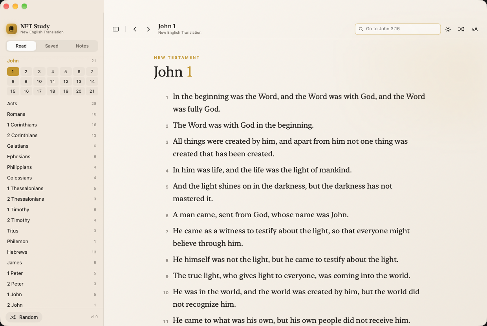

# NET Study

A native Apple silicon macOS study Bible reader built on the public NET Bible API
(`https://labs.bible.org/api/`). SwiftUI, no third-party dependencies, ~2.5 MB app.



## What it does

- **Full reference navigation** — 66 books with chapter grids, plus a "Go to" field
  that understands `John 3:16`, `rom 8:28-39`, `Ps 23`, `Jude 3`, and semicolon lists
  like `John 3:16-17; Psalms 23`.
- **Reading experience** — serif or sans text, adjustable size and column width,
  light/dark/system appearance, generous line spacing.
- **Verse actions** — click a verse number (or the ellipsis that appears on hover) to
  highlight in five colors, bookmark, copy with reference, or write a note.
- **Saved & Notes** — bookmarks and study notes live in the sidebar and jump straight
  back to the passage.
- **Verse of the Day and random passages** for when you don't know where to land.
- **Offline cache** — every passage you read is cached to disk, so recent readings
  still open without a connection.
- **Keyword search over the cache** — type a word or phrase in the search field and
  it searches every passage you've already opened (all words must match, case- and
  accent-insensitive). Arrow keys move through results, Return opens the verse and
  scrolls to it. Nothing is sent to the network for this.


## COMING SOON!!!
**Official study notes from the NET API**


## Install

Download `NET-Study-1.0.0-arm64.dmg` from
[Releases](https://github.com/occiderunt/netstudy-mac/releases/latest), open it, and
drag **NET Study** into Applications.

The app is ad-hoc signed, not notarized, so Gatekeeper blocks the first launch. Use
**right-click → Open** once, or clear the quarantine flag:

```
xattr -dr com.apple.quarantine "/Applications/NET Study.app"
```

Requires macOS 14 or later on Apple silicon (M1 or newer). There is no Intel build.

Prefer to build it yourself? `./build.sh` produces `build/NET Study.app`, and
`cp -R "build/NET Study.app" ~/Applications/` installs it without any quarantine
prompt, since nothing was downloaded.

## Keyboard shortcuts

| Shortcut | Action |
| --- | --- |
| `⌘F` | Focus the reference field |
| `⌘D` | Verse of the Day |
| `⌘R` | Random verse |
| `⌘]` / `⌘[` | Next / previous chapter |
| `⌘⌥S` | Toggle sidebar |

## Build from source

```bash
./build.sh
```

The script compiles `Sources/*.swift`, generates the icon, assembles the `.app`
bundle, and ad-hoc signs it.

One toolchain note: SwiftUI in the macOS 27 SDK declares `@State` and friends as
macros that live in Xcode's plugin directory, which the Command Line Tools don't
ship. `build.sh` therefore compiles against the `MacOSX26.5.sdk` (still a plain
property-wrapper SwiftUI) and deploys to macOS 14+, which runs fine on newer
systems. If you have full Xcode, you can switch `SDK` to `xcrun --show-sdk-path`.

## Data

Notes, highlights, bookmarks, history, and preferences are stored locally at:

```
~/Library/Application Support/NETStudy/state.json
```

Passage cache lives in `~/Library/Application Support/NETStudy/passages/`. Nothing
is sent anywhere except the passage reference itself to `labs.bible.org`.

## Attribution

Scripture text is the **New English Translation (NET Bible)**, © Biblical Studies
Press, served through the public NET Bible API at `labs.bible.org`. This app is an
unofficial reader and is not affiliated with Bible.org.

The GPL-3.0 license was specifically chosen to keep anyone from using the free-to-use and copyrighted NET Bible for illegal commercial gain.
